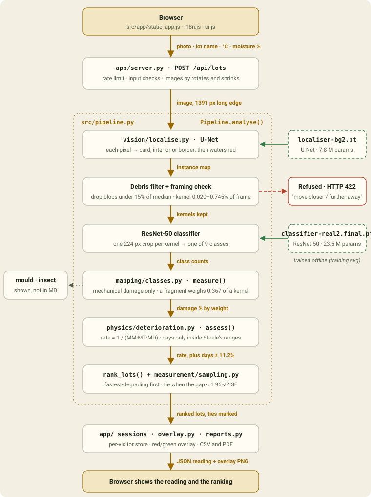
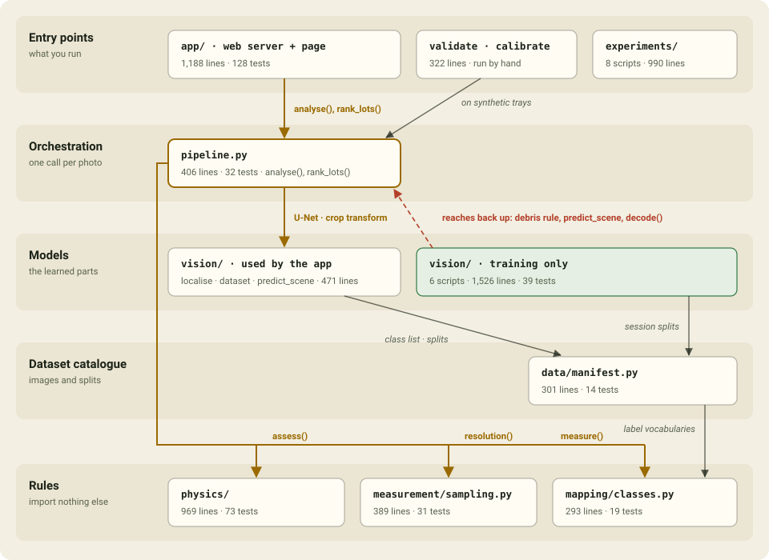
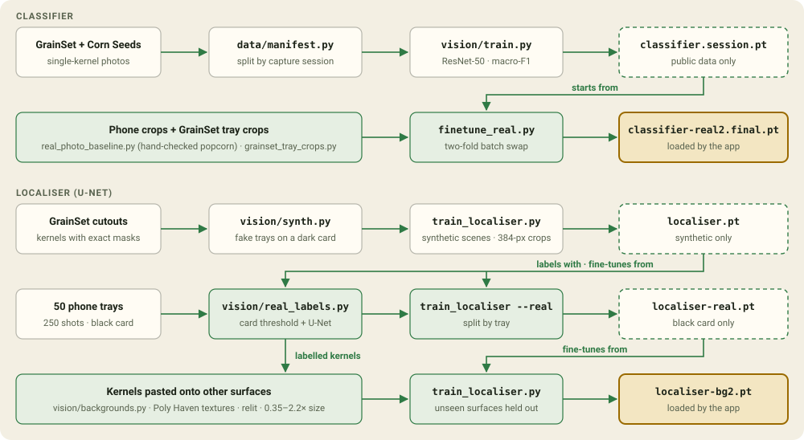

# Architecture

A tray photo goes in at the top and a ranked list of lots comes out at the
bottom. Two neural networks find and label the kernels; everything after them
is published arithmetic. Three pictures describe the code: the path one photo
takes, which modules depend on which, and how the two models are trained.

Sizes and test counts are as of commit `9ab2ad0`.

## What happens to one photo

`POST /api/lots` in `src/app/server.py` checks the inputs, and
`src/app/images.py` applies the photo's orientation tag and shrinks it to a
1391 px long edge. `Pipeline.analyse()` in `src/pipeline.py` then runs every
stage in order:

1. **Find the kernels.** The U-Net labels each pixel as card, kernel interior or
   kernel border. Interiors seed a watershed that grows back to whole kernels,
   which is how touching kernels come apart.
2. **Filter and check framing.** Blobs under 15% of the median kernel area are
   debris. A kernel must cover 0.020–0.745% of the frame, and at least 10 must be
   found, or the photo is refused with HTTP 422 and told which way to move the
   camera. The localiser has no scale invariance, so a close-up would otherwise
   produce a confident, wrong reading.
3. **Classify each kernel.** Each kernel's bounding box plus 4 px is resized to
   224 px and classified by ResNet-50 into one of 9 classes.
4. **Turn counts into damage.** `measure()` in `src/mapping/classes.py` keeps
   only mechanical damage (cracked, fragment) for the equation. Biological classes
   are reported and never enter it, and impurities leave both numerator and
   denominator. Damage is by weight: a fragment weighs 0.367 of a sound kernel.
5. **Run the deterioration model.** `assess()` in
   `src/physics/deterioration.py` computes Steele's (1967) moisture, temperature
   and damage multipliers. The ranking key is `1 / (MM · MT · MD)`. Days to the
   0.5% dry-matter-loss threshold appear only inside Steele's tested ranges, with
   his ±11.2% standard error.
6. **Rank.** `rank_lots()` orders lots fastest-degrading first. Two lots whose
   damage differs by less than `1.96 · √2 · SE` of a counted percentage
   (`src/measurement/sampling.py`) are reported as tied.

The reading is kept in the visitor's own in-memory session
(`src/app/sessions.py`, `store.py`). `overlay.py` draws the damaged kernels in
red and the rest in green, and `reports.py` writes the CSV and PDF in English,
Hindi or Telugu.

## Who depends on whom

Imports point down. The three rule modules import nothing else in the
project, so the physics can be checked by hand without the models. The one
upward import is in the training code: `train_localiser.py` uses the pipeline's
debris rule, and `real_labels.py` uses `predict_scene` and `app/images.decode()`.

| Module | What it does | Lines | Tests |
|---|---|---|---|
| `src/app/` | FastAPI server, validation, per-visitor sessions, overlay, CSV/PDF reports, the page (`static/`) | 1,188 + 52 KB static | 128 + 5 JS |
| `src/pipeline.py` | One photo through every stage; framing check; ranking with ties | 406 | 32 |
| `src/vision/` (runtime) | `localise.py` (U-Net and watershed), `evaluate_localiser.py` (`predict_scene`), `dataset.py` (classes, crop transform) | 471 | via `test_pipeline` |
| `src/vision/` (training) | `train.py`, `train_localiser.py`, `synth.py`, `real_labels.py`, `backgrounds.py`, `calibrate.py` | 1,526 | 39 |
| `src/data/manifest.py` | GrainSet and Corn Seeds images with labels, split by capture session | 301 | 14 |
| `src/mapping/classes.py` | The 9 classes and their admissibility; counts to damage by weight | 293 | 19 |
| `src/measurement/sampling.py` | Standard error, resolvable gap, kernels needed, calibration line | 389 | 31 |
| `src/physics/` | Steele multipliers, days to threshold, humidity to moisture, agreement with Steele's published numbers | 969 | 73 |
| `src/validate_pipeline.py`, `calibrate_pipeline.py` | Synthetic trays of known damage through the whole pipeline; correction-line fit | 322 | run by hand |
| `experiments/` | Model comparison, scale test, real-photo scoring and the classifier fine-tune | 990 | none |

## How the two models are trained

Training never runs inside the app. Each model is a chain of fine-tunes, and
the app loads the last link of each (highlighted):

- **Classifier.** `vision/train.py` trains ResNet-50 on GrainSet and Corn Seeds,
  split by capture session, into `classifier.session.pt`.
  `experiments/finetune_real.py` fine-tunes it on hand-checked phone crops
  (`experiments/real_photo_baseline.py`) plus GrainSet kernels cut out of
  synthetic trays (`experiments/grainset_tray_crops.py`), giving
  `classifier-real2.final.pt`.
- **Localiser.** `vision/synth.py` composes fake trays from GrainSet cutouts and
  `train_localiser.py` trains `localiser.pt` on them. That model auto-labels 50
  phone trays (`vision/real_labels.py`) and is fine-tuned on them, split by tray,
  into `localiser-real.pt`. `vision/backgrounds.py` then pastes the labelled
  kernels onto other surfaces, relights them and resizes them 0.35–2.2×, and a
  further fine-tune gives `localiser-bg2.pt`.

Weight files live in `models/`, which git ignores.
